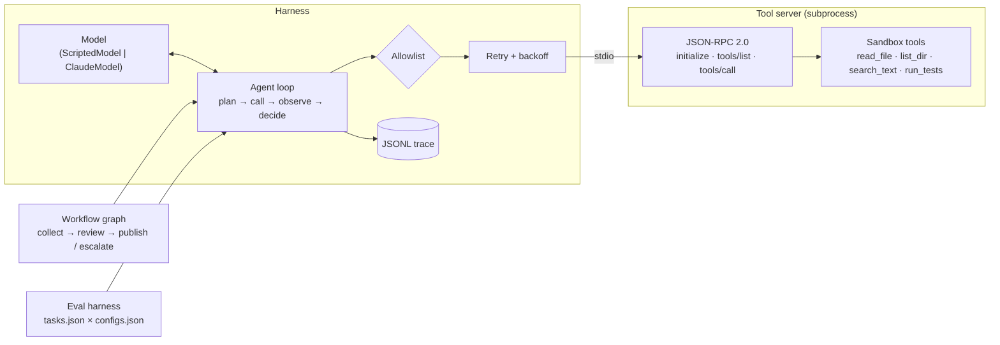

# mcp-agent-loop

A small agent harness that shows how to run an AI agent with clear limits, a full trace, and a repeatable evaluation.
Everything runs offline with the Python standard library. A Claude model is optional.

## Problem

An agent that calls tools is easy to demo and hard to trust. Most of the risk sits outside the model:
unbounded loops, flaky tools, tools that touch things they should not, and changes that "feel better" but were never measured.
This project puts those concerns in the harness, where you can test them:

- Tools live behind a protocol boundary (the Model Context Protocol shape: JSON-RPC 2.0 over stdio).
- The loop has explicit stop rules: completion check, max steps, wall-clock budget, and token budget.
- Transient tool failures get retries with exponential backoff. Real tool errors do not.
- A permission allowlist is enforced at call time, not only in the prompt.
- Every step goes to a JSONL trace.
- An eval set with executable checks compares two configurations side by side.

## Architecture



| Module | Role |
| --- | --- |
| `protocol.py` | JSON-RPC 2.0 framing, error codes, one message per line. |
| `server.py` | MCP-shaped server. Requires `initialize` first, validates tool arguments, maps failures to results or error codes. |
| `tools.py` | Four demo tools. Every path resolves inside one sandbox root. `run_tests` runs `unittest` in a subprocess with a timeout. |
| `client.py` | `StdioClient` (spawns the server) and `InProcessClient` (same JSON lines, no subprocess, for fast tests). |
| `models.py` | `Model` protocol, a deterministic `ScriptedModel`, and a lazy `ClaudeModel` adapter. |
| `agent.py` | The loop, its limits, retries, permission checks, and completion check. |
| `trace.py` | JSONL tracer. Flushes each event. |
| `graph.py` | Workflow engine: nodes, edges, branches, shared state, per-node retries, human-review node. |
| `evals.py` | Loads tasks, runs checks, scores, and compares two configs. |

## How to run

Requires Python 3.12. No install is needed for the offline path.

```bash
python3 -m pip install pytest      # only for the tests
make test                          # or: python3 -m pytest -q
make demo                          # or: python3 -m mcp_agent_loop demo
make eval                          # or: python3 -m mcp_agent_loop eval
make workflow                      # or: python3 -m mcp_agent_loop workflow --auto-approve
make typecheck                     # mypy --strict on the package (needs mypy)
```

The demo starts the tool server as a subprocess and talks to it over stdio.
It injects one transient failure so you can see a retry.
The trace goes to `traces/demo.jsonl`.

To use Claude instead of the scripted model:

```bash
python3 -m pip install anthropic
export ANTHROPIC_API_KEY=...
export ANTHROPIC_MODEL=claude-sonnet-5-5   # optional; this is the default
python3 -m mcp_agent_loop demo --model claude
```

The `anthropic` package is imported only when you pick `--model claude`.
Without a key the command stops with a clear error.

## Sample output

`make demo`:

```text
[start] model=scripted tools=read_file,list_dir,search_text,run_tests
[1] think: Orient: see what is in the workspace.  ->  call list_dir({"path": "."})
[1]   retry #1 in 0.05s (rpc error -32001: transient failure (injected))
[1]   ok: README.md | VERSION.txt | notes/ | sample_repo/
[2] think: Read the version file.  ->  call read_file({"path": "VERSION.txt"})
[2]   ok: 1.4.2 |
[3] think: Try a shell grep for TODOs.  ->  call run_shell({"cmd": "grep -r TODO ."})
[3]   DENIED: run_shell is not in the allowlist
[4] think: Shell is not allowed; use the search tool.  ->  call search_text({"query": "TODO"})
[4]   ok: notes/todo.md:1: # TODO | sample_repo/calc.py:12: # TODO: add divide() with a clear error
[5] think: Run the sample test suite.  ->  call run_tests({"path": "sample_repo"})
[5]   ok: exit_code=0 | ... | ----------------------------------------------------------------------
[6] think: Enough evidence; summarize.  ->  finish
[end] status=completed steps=6 tokens~206 tool_errors=1 retries=1 elapsed=0.2084s
```

One trace line:

```json
{"ts": 1793926288.453, "run_id": "demo", "step": 1, "event": "decision", "thought": "Orient: see what is in the workspace.", "tokens": 12, "tool": "list_dir", "arguments": {"path": "."}, "answer": null}
```

`make eval` (end of output):

```text
metric              baseline    hardened     delta
success_rate           0.625         1.0    +0.375
mean_steps              2.38         2.5     +0.12
p50_latency_s         0.0003      0.0004   +0.0001
max_latency_s         0.0012      0.0507   +0.0495
tool_errors                3           1        -2
retries                    0           1        +1
changed tasks: run-tests: FAIL->PASS, flaky-read: FAIL->PASS, multi-file-summary: FAIL->PASS
```

`baseline` has no retries, a 4-step cap, and no `run_tests` permission.
`hardened` allows retries, 8 steps, and the test tool.
The table shows which task each change fixes, and the cost: one retry adds about 50 ms to the slowest task.

## Eval set

`evals/tasks.json` holds 8 bounded tasks. Each task has a goal, a plan for the scripted model, and executable checks:
`status`, `answer_contains`, `answer_regex`, `tool_called`, `max_steps`, and `min_tool_errors`.
Tasks cover a plain read, search, a test run, an injected transient failure, a multi-step task,
a sandbox escape attempt (must be refused), and an early "finish" that the completion check rejects.

Run the same tasks against Claude with `python3 -m mcp_agent_loop eval --model claude`.
The plans are then ignored and the checks still apply.

## Design trade-offs

- **Scripted model first.** A deterministic model makes the harness testable without network, keys, or cost.
  The price is that the offline evals measure the harness, not model quality.
- **One tool call per step.** It keeps the trace and the budgets simple. Parallel calls would be faster on wide tasks.
  The Claude adapter asks for one call per turn to match.
- **Retry only what is safe to retry.** Transport timeouts and the server's "transient" code (-32001) are retried.
  A tool that ran and failed (`isError: true`) is shown to the model instead, because a retry would give the same answer.
- **Allowlist in two places.** Denied tools are hidden from the model and also blocked at call time,
  because a model can name a tool it was never shown.
- **Rough token count offline.** The scripted path estimates 4 characters per token. The Claude path uses real usage numbers.
- **Append-only Claude history.** The adapter sends earlier assistant turns back unchanged instead of rebuilding them,
  so model output is never edited between turns.
- **Small graph engine, not a framework.** It covers branches, retries, loops with a transition cap, and a review gate.
  It has no persistence or parallel branches.

## Limitations

- The server is MCP-shaped, not a full MCP implementation. It has tools only: no resources, prompts, or progress notifications.
- Argument validation checks required keys, unknown keys, and top-level types. It is not full JSON Schema.
- After a stdio timeout, a late reply from the server can arrive out of order. The client then fails on an id mismatch and does not resync.
- `run_tests` isolates the path and the environment, but it is not a security sandbox. Do not point it at untrusted code.
- The Claude adapter is covered by tests with a fake client. A live run needs your own key.
- The wall-clock budget is checked between steps, so one slow tool call can overrun it by up to the tool timeout.

## What I'd do next

- Add an LLM-judge check next to the exact checks, and track how often the two disagree.
- Run each eval task several times against a live model and report the variance, not only the mean.
- Add per-tool cost and latency budgets, and a circuit breaker for a tool that keeps failing.
- Cancel tool calls when the wall-clock budget runs out.
- Persist graph state so a human review can pause a workflow and resume it later.
- Implement more of MCP (resources, `listChanged`) and test against a third-party MCP client.
- Export traces as OpenTelemetry spans.

## License

MIT. See [LICENSE](LICENSE).
